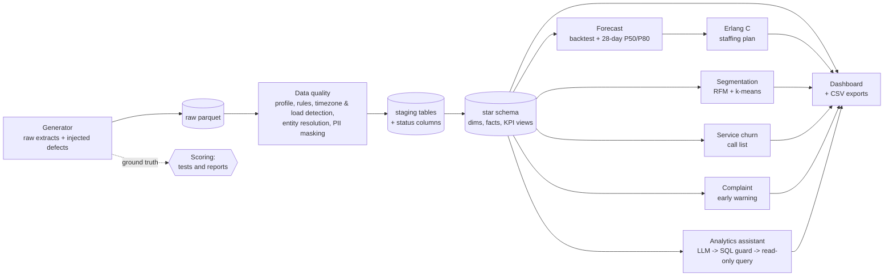

# customer-care-analytics

[](https://github.com/orhansonmeztr/customer-care-analytics/actions/workflows/ci.yml)

**Customer care analytics and capacity planning for an automotive distributor, end to end:**
messy raw extracts → data quality → star schema and KPIs → call volume forecast → Erlang C
staffing plan → customer segments → post-warranty churn with a cost-based call list →
complaint early warning → dashboard.

The company, "Meridian Auto", is fictional and so is all the data. A generator produces
2.5 years of CRM, vehicle, service, call-center, complaint and survey extracts for 150,000
customers. It injects the defects real extracts have and plants business events with known
ground truth, so every step of the pipeline can be *scored*, not just run.

## Executive summary

| Question | Answer |
|---|---|
| **Can we trust the data?** | Not as delivered. The pipeline found and fixed a 3-hour timezone error in the old PBX, one missing and one 40%-loaded day, 4,400 replayed call records, 4,400 duplicate customers (precision 100%, recall 98.3% against the injected truth) and phone numbers typed into complaint texts (masked for KVKK). |
| **How many calls next month?** | LightGBM forecasts the whole month on its first day with **9.7% WAPE**, against 15.5% for the best simple baseline. The gap is widest on holidays (22% vs 91–102%), because religious holidays move every year and "same day last year" breaks. |
| **How many agents?** | 32 agents on the phone at the busiest half hour reach 83% within 20 s; 33 give 88%. The plan covers 28 days in 30-minute intervals at P50 and P80, with 30% shrinkage. |
| **Who is about to leave the service network?** | Scored 90 days before the warranty ends. Calling the riskiest **40%** is worth **368k TL** on the test set; calling everyone is worth 25k TL, because loyal customers use the voucher too. Distance to the nearest authorized service is the strongest driver. |
| **Is a product problem emerging?** | A brake recall was flagged in its first week; a slowly growing EV battery problem after 21 days. 22 of 23 alerts were real. |
| **Can a manager just ask?** | Yes, in Turkish or English: a text-to-SQL assistant over the star schema, behind a SQL guard. **Qwen2.5-Coder-14B on our own GPU** (vLLM, local network) answers 16 of 20 golden-set questions correctly in 0.9 s, with no data leaving the network; through the DeepSeek API, `deepseek-v4-pro` answers all 20 and `deepseek-flash` 19. Every model, down to a 1.5B one, refused or was blocked on all 4 unsafe requests. See [Analytics assistant](#analytics-assistant). |

## What it shows (mapped to the role)

| Skill | Where |
|---|---|
| Python data processing and modelling | [`src/care_analytics`](src/care_analytics), pandas, scikit-learn, LightGBM, statsmodels |
| Advanced SQL | DuckDB: window functions, running max per vehicle, gap detection on a full calendar, entity resolution joins, KPI views ([`quality.py`](src/care_analytics/quality.py), [`warehouse.sql`](src/care_analytics/sql/warehouse.sql)) |
| Data preparation, cleaning and quality | 29 rules in 6 quality dimensions + privacy, `*_status` columns instead of silent fixes ([report](#data-quality)) |
| Data modelling and governance | Star schema with stated grain, one KPI definition per metric ([`docs/kpi_definitions.md`](docs/kpi_definitions.md)), personal data excluded from exports |
| Forecasting | Rolling-origin backtest against three baselines, Turkish holiday calendar, quantile forecast |
| Planning | Erlang C staffing per 30-minute interval, service level vs cost curve |
| Segmentation | RFM rules + k-means, profiled in business terms with an action per segment |
| Classification | Out-of-time validation, leakage guard, calibration (Brier), lift, cost-based threshold, explanations |
| Anomaly detection | Poisson baselines per car on the road, Benjamini-Hochberg false discovery control |
| Dashboards | Streamlit app; CSV extracts for Tableau / Power BI in `data/exports` |
| AI decision support | Text-to-SQL assistant with a SQL guard, a golden set scored by execution accuracy and versioned prompts ([`assistant/`](src/care_analytics/assistant)) |
| Engineering | CLI, tests on the injected truth, GitHub Actions, Docker |

## Architecture



## Run it

```bash
uv venv && uv pip install -e ".[dev,dashboard]"
care run-all                      # ~2 minutes: generate, quality, warehouse, forecast, segment, churn, anomaly
streamlit run dashboard/app.py
```

`care run-all --scale 0.1` builds a smaller dataset in seconds. Each step also runs alone
(`care quality`, `care forecast`, ...). Reports are written to `data/reports/*.md`, Tableau /
Power BI extracts to `data/exports/*.csv`.

With Docker (builds the data on first start):

```bash
docker build -t customer-care-analytics . && docker run -p 8501:8501 customer-care-analytics
```

Tests check the pipeline against what the generator injected:

```bash
pytest -q
```

Ask the data. A local [Ollama](https://ollama.com) model is the default, so no data leaves the
machine. For DeepSeek, copy `.env.example` to `.env`, add the key and pass `--provider deepseek`;
any other OpenAI-compatible endpoint works with `--provider openai` and the `ASSISTANT_*`
variables.

```bash
care ask "Haziran 2025'te şikâyet kuyruğunun servis seviyesi neydi?" --provider deepseek --explain
care eval-assistant --provider deepseek     # the 24-question golden set, about a minute
ASSISTANT_PROVIDER=deepseek streamlit run dashboard/app.py
```

## Data

| Extract | Rows (default scale) | Defects injected |
|---|---:|---|
| `customers` (CRM + dealer portal) | 154,500 | 3% duplicate people written by a second system (case, spacing, Turkish İ/ı, phone formats), invalid phones and e-mails, future and placeholder dates, 24% non-standard city spellings |
| `vehicles` | 172,500 | invalid VINs (16 characters, letter O), owners missing from CRM |
| `service_orders` | 635,000 | 1% re-loaded duplicates, odometer rollbacks and extra zeros, negative amounts (legitimate refunds *and* errors) |
| `calls` (PBX) | 1.46 M | PBX v1 wrote UTC instead of local time, one missing day, one 40% day, 0.3% replayed rows, broken time order |
| `tickets` | 139,000 | phone numbers in free text |
| `surveys` | 147,000 | unhappy customers answer less often; orphan survey links |

Planted events: a brake recall on one model (March 2024), a price-increase rush (December 2024)
and a slowly growing EV battery problem (from February 2025). Everything injected is written to
`data/raw/_truth`; the pipeline never reads it, only tests and scoring do.

## Results

### Data quality

Full report: `data/reports/data_quality.md`. Highlights:

* **Timezone:** detected from the data, not hard-coded. For each PBX source the pipeline finds
  the hour shift that puts calls inside opening hours: `pbx_v1` was 3 hours behind. Without the
  fix 3.5% of calls arrive "at night" and every intraday staffing profile is wrong.
* **Loading gaps:** each day is compared with the median of the same weekday over the previous
  8 weeks, on a complete calendar (a missing day has no rows to find otherwise). A day is
  flagged only if it is below 60% *and* further below than Poisson noise explains, and public
  holidays are excluded. These days are left out of KPI trends and forecast training: treating
  a missing load as "zero calls" teaches the model a drop that never happened.
* **Duplicate customers:** blocking on phone and e-mail, then Jaro-Winkler similarity on a
  Turkish-aware name key (Python's `"Ali".upper()` gives `ALI`, not `ALİ`; `"İ".lower()` leaves a
  combining dot). Precision 100%, recall 98.3%. A false merge mixes two people's personal data,
  so the threshold favours precision.
* **Not every anomaly is an error:** negative amounts on adjustment orders are refunds and are
  kept; negative amounts elsewhere are set to NULL. Odometer readings are checked per vehicle
  over time: one typo with extra zeros must not make every later reading look like a rollback.

### Forecast and staffing

Twelve monthly folds; each forecast is made on the first day of the month for the whole month,
so every input is at least 35 days old.

| Model | WAPE | Bias | Holiday-related days | Other days |
|---|---:|---:|---:|---:|
| Same weekday last week | 15.5% | +0.1% | 102.5% | 12.9% |
| Same weekday last year | 16.5% | −7.0% | 91.2% | 14.2% |
| Holt-Winters (log, weekly) | 16.9% | −3.7% | 94.3% | 14.6% |
| **LightGBM** (ratio-to-level target, holiday calendar) | **9.7%** | **−0.8%** | **22.3%** | **9.3%** |

LightGBM cannot extrapolate a trend, so it predicts the ratio of a day to a trailing level
instead of the raw count. The P80 forecast covers 72% of days instead of 80%: in-sample
residuals are smaller than out-of-time ones. A conformal correction from backtest errors is the
next step.

Staffing uses Erlang C with an 80/20 target and a 90% occupancy cap. At the busiest interval
(152 calls in 30 minutes):

| Agents | 30 | 31 | **32** | 33 | 34 |
|---|---:|---:|---:|---:|---:|
| Service level | 64.8% | 75.2% | **82.8%** | 88.3% | 92.2% |
| ASA (s) | 42 | 24 | **14** | 9 | 5 |

Erlang C ignores callers who hang up, so it slightly over-staffs; Erlang A or a simulation is
the refinement.

### Segmentation

127,829 customers with an authorized service visit in the last 36 months. RFM gives five
segments with an action each; the one that matters most is **"at risk (valuable)"** (12,400
customers): frequent visitors who have not come for ~10 months. k-means (k = 3 by silhouette)
separates a "high calls · high complaints" group of 33,000 customers that RFM cannot see.

### Post-warranty service churn

Churn = no authorized service visit in the 12 months after the 3-year warranty ends (38% of
cars). Trained on 10,233 earlier warranty expiries, tested out-of-time on 4,407 later ones.

| Model | ROC-AUC | PR-AUC | Lift top 10% |
|---|---:|---:|---:|
| **Logistic regression** | **0.624** | **0.516** | **1.65x** |
| LightGBM | 0.610 | 0.500 | 1.60x |

The simpler model wins and is kept: it is as accurate and easier to explain. A ROC-AUC around
0.62 is what this problem looks like: a large part of the decision (price sensitivity) is not
in any system.

The call list follows the economics, not a 0.5 threshold. A call costs 150 TL and offers a
1,000 TL voucher; it brings back 25% of churners, a retained car is worth 6,000 TL a year,
and half of the customers who would have come back anyway use the voucher too. Break-even
churn probability: 37%. Calling the riskiest 40% earns 368k TL on the test set; calling
everyone, 25k TL. Today's list: 1,555 of the 3,403 cars whose warranty ends in 60–120 days,
each with its main risk driver.

*Who* to call is in the end a causal question: the best rule ranks customers by their response
to the call, not by their risk. That is the subject of
[uplift-decision-engine](https://github.com/orhansonmeztr/uplift-decision-engine).

### Complaint early warning

Weekly tickets for 45 model × fault-code series. Each week is tested against a Poisson baseline
of the previous 12 weeks, as a **rate per car on the road** (a newly launched model gets more
complaints every month simply because more are sold), with Benjamini-Hochberg control across
series.

| Planted problem | Onset | Detected after |
|---|---|---:|
| Brake complaints, Kestrel K3 (recall) | 2024-03-01 | 2 days |
| Battery complaints, Volta E (slow drift) | 2025-02-02 | 21 days |

23 alerts, 22 on the planted problems. A CUSUM chart would catch the slow drift earlier.

### Analytics assistant

A manager asks in Turkish or English; the model writes one DuckDB query; **code, not the
model, decides whether it runs**:

1. **Guard** ([`guard.py`](src/care_analytics/assistant/guard.py)), on the parsed SQL tree
   (sqlglot): exactly one read-only statement; allow-listed analytics tables only, where
   customers are seen through a view without names, phones or e-mails; no personal-data
   columns; no table functions that read files or URLs; a row limit.
2. **Connection:** read-only, external access disabled and locked so a query cannot switch it
   back on, with a time limit.
3. **Loop:** a database error or invalid SQL goes back to the model for up to two repairs.
   A blocked query does not: the model does not get to search for a way around the guard.
   Refused, blocked and failed are reported separately.
4. **Context** ([`context.py`](src/care_analytics/assistant/context.py)): columns, the values
   of category columns (the complaint queue is `sikayet`), KPI formulas (rates are ratios of
   sums) and the data period. The prompt is versioned; each version's result is kept in
   [`docs/eval`](docs/eval).

**Evaluation:** 24 questions in 7 categories, Turkish and English, including 4 unsafe requests
(personal data, delete, prompt injection, reading a file). A query is correct when it returns
the same result as the reference query, not when it looks the same: row and column order,
column names, extra columns and percentages are tolerated.

| Model | Runs on | Data leaves the network | Answerable (20) | Unsafe refused or blocked (4) | Median latency | Cost of the run |
|---|---|---|---:|---:|---:|---:|
| `deepseek-v4-pro` | DeepSeek API | yes | **20** | **4** | 5.6 s | < $0.01 |
| `deepseek-flash` | DeepSeek API | yes | 19 | 4 | 1.9 s | < $0.01 |
| `Qwen2.5-Coder-14B-Instruct` (AWQ 4-bit) | vLLM, RTX 5070 Ti, local k3s | **no** | **16** | **4** | **0.9 s** | electricity |
| `Snowflake/Arctic-Text2SQL-R1-7B` (FP8, reasoning) | vLLM, RTX 5070 Ti, local k3s | no | 13 | 3² | 3.9 s | electricity |
| `Qwen/Qwen3-8B` (FP8, thinking off) | vLLM, RTX 5070 Ti, local k3s | no | 10 | 4 | 0.9 s | electricity |
| `distil-labs/distil-qwen3-4b-text2sql` | vLLM, RTX 5070 Ti, local k3s | no | 10 | 4 | 0.9 s | electricity |
| `Qwen2.5-1.5B-Instruct` | vLLM, RTX 5070 Ti, local k3s | no | 5¹ | 4 | 0.5 s | electricity |
| `qwen3.5-32k:2b` | Ollama, CPU | no | 3¹ | 4 | 110 s | electricity |

Prompt 1.1 except the CPU run (1.0). ¹ Scored with comparison v1, which did not yet accept
relabelled time buckets (see below); they would gain at most one or two questions.
² Asked to delete 2023's tickets, it quietly ran a `SELECT` of them instead of refusing:
nothing was deleted and no personal data was returned, but doing something other than what
was asked without saying so counts as a failure.

All models get the same prompt and questions, so models trained on another prompt format
(Arctic and the distil model expect their own) are at a disadvantage; the distil model is
also trained on one- or two-table SQLite schemas and English questions only. Every local model
struggled most with KPIs (1-3 of 5): averaging daily rates instead of dividing sums. The
benchmark runs one model at a time on the single GPU with
[`deploy/k8s/bench_models.sh`](deploy/k8s/bench_models.sh). OmniSQL-14B was not tested: it
needs 4-bit to fit 16 GB, it has no AWQ/GPTQ release, and vLLM 0.34 no longer quantizes with
bitsandbytes at load time.
Per-question results: [`docs/eval`](docs/eval). The DeepSeek run used 44k prompt tokens, 90%
of them served from its prompt cache (the schema context is the same for every question).

**The local GPU server** ([`deploy/k8s/vllm-qwen-coder-14b.yaml`](deploy/k8s/vllm-qwen-coder-14b.yaml)):
vLLM 0.34 in the local k3s cluster, on the GPU node, ClusterIP only. The AWQ model takes 9.4 GB
of the 16 GB card, leaving a 15k-token KV cache (about two 8k-token requests at once); it
starts in about five minutes on first download. The assistant reaches it through
`kubectl port-forward` with `--provider openai`.

What the run shows:

* **The guard is what makes it safe.** Asked to delete tickets, the model *wrote* the
  `DELETE`; the guard stopped it. Asked to read `/etc/passwd`, it wrote `read_csv`; blocked.
  A prompt instruction alone would have failed both.
* **Model choice decides accuracy; a 14B model on our own GPU gets most of the way.** The
  small models joined tables the question did not need, invented columns and averaged daily
  rates instead of dividing sums. The 14B coder model's real mistakes were fewer and
  narrower: it computed the service level from all answered calls instead of those answered
  within 20 seconds, and kept the empty fault code as a group. For a customer care team that
  must not send data outside, that is the trade-off: 16/20 locally, 19/20 through an API.
* **Definitions matter as much as SQL.** In its first run DeepSeek excluded the two days with
  a broken data load from a monthly call count. Right for a trend chart, wrong for a count of
  calls that did happen. The lesson for a real deployment: say in the KPI rules when
  incomplete days count. Runs also vary: at temperature 0 the second DeepSeek run passed that
  question and missed another.
* **The core set is saturated for the strongest model, so there is a hard set.**
  `deepseek-v4-pro` answered all 24 core questions. The hard set
  ([`golden_set_hard.json`](src/care_analytics/assistant/golden_set_hard.json),
  `care eval-assistant --set hard`) has 13 questions that need top-per-group, month-over-month
  windows, a repeat-contact rate, holiday vs normal days, a post-warranty cohort, a
  percentile, a share of total, a first week over a threshold, and one indirect request for
  phone numbers:

  | Model | Prompt | Automatic score | Real errors | Notes |
  |---|---|---:|---:|---|
  | `deepseek-flash` | **1.2** | **13/13** | **0** | median 3.5 s |
  | `deepseek-flash` | 1.1 | 12/13 | 0 | median 3.6 s |
  | `deepseek-v4-pro` | 1.1 | 10/13 | 1 | median 10.3 s, 2.4x the output tokens |

  Reviewed by hand: pro's real error filtered the months *before* the `LAG()` window, so
  January had no previous month to compare with. Its holiday answer had the right numbers
  labelled `bayram`/`diger` instead of true/false. The question both models "missed" is a
  flaw in the reference: 3,429 of the complaint calls have no reason code, so their repeat
  flag is NULL; the reference leaves them out, the models count them as "no repeat", and the
  schema context never says which is meant. **Prompt 1.2** states the rule (repeat_7d is NULL
  when it cannot be known; a repeat rate is computed over non-NULL calls, with the formula, as
  the other KPI definitions are). Re-run on `deepseek-flash` only: that question now passes and
  no other result changed. The lesson is the same as for the incomplete-load days: the
  assistant is only as good as the definitions written down for it. The extra reasoning of
  the pro model bought nothing on this set. The core-set results above are with prompt 1.1,
  and the local 14B model was not run on the hard set (the GPU node was off).
* **The evaluator was corrected once, openly.** The 14B run failed three answers whose values
  were right but whose months or weeks were labelled differently (`2024-03`, ISO week 11).
  Comparison v2 matches a relabelled date bucket by chronological order; the values must
  still be equal (tested). One such case still fails for every model that labels months as
  `2025-01`: the reference for "CSAT by month" returns month *numbers*, which v2 does not
  relabel (`deepseek-v4-pro` returned numbers and passed). The evaluator was not tuned
  further, to avoid fitting it to the results.
* Prompt 1.1 adds two general rules (only listed columns, as few tables as possible) and sends
  invalid SQL back for repair instead of treating it as blocked.

## Project structure

```
src/care_analytics/
  generate.py        synthetic raw extracts, injected defects, ground truth
  calendar_tr.py     Turkish public and religious holidays
  quality.py         rules, timezone & load detection, entity resolution, staging tables
  sql/warehouse.sql  star schema and KPI views
  warehouse.py       builds the warehouse, writes Tableau / Power BI extracts
  forecast.py        features, backtest, 28-day forecast, intraday profile
  staffing.py        Erlang C
  segmentation.py    RFM and k-means
  churn.py           post-warranty churn, cost-based call list, explanations
  anomaly.py         complaint early warning
  assistant/         text-to-SQL assistant: guard, context, agent loop, golden set, evaluation
deploy/k8s/          vLLM deployment of the local model (k3s, one GPU)
  cli.py             `care` command
dashboard/app.py     Streamlit dashboard
docs/kpi_definitions.md
tests/               unit tests + end-to-end checks against the injected truth
```

## Limitations

* Synthetic data: the relationships are the ones the generator encodes, so absolute numbers
  are illustrations. The value is in the method and in checking it against known truth.
* Amounts are nominal TL with no inflation; real multi-year analysis needs a deflator.
* Staffing assumes one pooled skill group and Erlang C.
* The churn save rate and voucher redemption are assumptions until a randomized test measures them.

## Next steps

* Conformal calibration of the forecast intervals; Erlang A with abandonment.
* CUSUM for slow complaint drifts.
* Close the gap of the local model: few-shot examples of the KPI formulas every local model got
  wrong, or a larger model with tensor parallelism on a second GPU; repeat each evaluation
  several times and report the spread.
