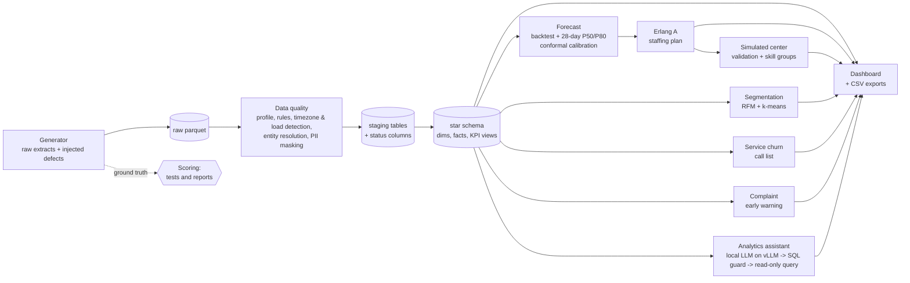

# customer-care-analytics

[](https://github.com/orhansonmeztr/customer-care-analytics/actions/workflows/ci.yml)

**Customer care analytics and capacity planning for an automotive distributor, end to end:**
messy raw extracts → data quality → star schema and KPIs → call volume forecast with a
calibrated P80 → Erlang A staffing, checked against a simulated center, across skill groups →
customer segments → post-warranty churn with a cost-based call list → complaint early
warning → dashboard, plus a text-to-SQL assistant that runs on our own GPU.

The company, "Meridian Auto", is fictional and so is all the data. A generator produces
2.5 years of CRM, vehicle, service, call-center, complaint and survey extracts for 150,000
customers. It injects the defects real extracts have and plants business events with known
ground truth, so every step of the pipeline can be *scored*, not just run.

**Live dashboard:** [Meridian Auto on Tableau Public](https://public.tableau.com/app/profile/orhan.s.nmez/viz/MeridianAuto-CustomerCareAnalytics/MeridianAutocustomercare), built from the CSV extracts
(see [Tableau Public dashboard](#tableau-public-dashboard)).

## Executive summary

| Question | Answer |
|---|---|
| **Can we trust the data?** | Not as delivered. The pipeline found and fixed a 3-hour timezone error in the old PBX, one missing and one 40%-loaded day, 4,400 replayed call records, 4,400 duplicate customers (precision 100%, recall 98.3% against the injected truth) and phone numbers typed into complaint texts (masked for KVKK). |
| **How many calls next month?** | LightGBM forecasts the whole month on its first day with **9.3% WAPE**, against 15.2% for the best simple baseline. The gap is widest on holidays (19% vs 87–101%), because religious holidays move every year and "same day last year" breaks. |
| **How many agents?** | Planned on a conformal-calibrated P80 forecast with **Erlang A**, which models callers who hang up (patience estimated from the data: 115 s). It needs **4.3% fewer agent hours** than Erlang C for the same 80/20 target, with abandonment capped at 5%; the Erlang C plan would over-deliver at 92%. In a simulated, staffed center Erlang A predicts the service level within 6 points, Erlang C within 27. Staffing the four queues as separate groups costs 37% more hours than one pooled group; cross-training half of the agents gets most of that back. 28 days in 30-minute intervals, 30% shrinkage. |
| **Who is about to leave the service network?** | Scored 90 days before the warranty ends. Calling the riskiest **45%** is worth **350k TL** on the test set; calling everyone is worth 26k TL, because loyal customers use the voucher too. Distance to the nearest authorized service is the strongest driver. |
| **Is a product problem emerging?** | A brake recall was flagged in its first week; a slowly growing EV battery problem after 21 days. 28 of 29 alerts were real. A daily CUSUM was tested against it: it caught the drift at most 4 days earlier, and only with four times the false alarms. |
| **Can a manager just ask?** | Yes, in Turkish or English: a text-to-SQL assistant over the star schema, behind a SQL guard. **Qwen2.5-Coder-14B on our own GPU** (vLLM, local network), with no data leaving the network, answers **11 of 12 held-out questions**, the same as `deepseek-flash` through the DeepSeek API; on the everyday set it gets 21 of 24 against flash's 24. Prompt 1.3 (KPI and pattern examples) lifted the local model from 6 to 11 on questions that played no part in writing it. The local model is the default; DeepSeek is used only when chosen explicitly, because data then leaves the network (see [recommended configuration](#recommended-configuration)). See [Analytics assistant](#analytics-assistant). |

## What it shows (mapped to the role)

| Skill | Where |
|---|---|
| Python data processing and modelling | [`src/care_analytics`](src/care_analytics), pandas, scikit-learn, LightGBM, statsmodels |
| Advanced SQL | DuckDB: window functions, running max per vehicle, gap detection on a full calendar, entity resolution joins, KPI views ([`quality.py`](src/care_analytics/quality.py), [`warehouse.sql`](src/care_analytics/sql/warehouse.sql)) |
| Data preparation, cleaning and quality | 29 rules in 6 quality dimensions + privacy, `*_status` columns instead of silent fixes ([report](#data-quality)) |
| Data modelling and governance | Star schema with stated grain, one KPI definition per metric ([`docs/kpi_definitions.md`](docs/kpi_definitions.md)), personal data excluded from exports |
| Forecasting | Rolling-origin backtest against three baselines, Turkish holiday calendar, quantile forecast with a conformal-calibrated P80 |
| Planning | Erlang C and Erlang A (callers who hang up, patience estimated from the data) per 30-minute interval; both validated against a discrete-event simulation; dedicated vs cross-trained vs pooled skill groups ([`queue_sim.py`](src/care_analytics/queue_sim.py), [`skills_routing.py`](src/care_analytics/skills_routing.py)) |
| Segmentation | RFM rules + k-means, profiled in business terms with an action per segment |
| Classification | Out-of-time validation, leakage guard, calibration (Brier), lift, cost-based threshold, explanations |
| Anomaly detection | Poisson baselines per car on the road, Benjamini-Hochberg false discovery control; a daily Poisson CUSUM compared by false alarms |
| Dashboards | Streamlit app; a [Tableau Public dashboard](https://public.tableau.com/app/profile/orhan.s.nmez/viz/MeridianAuto-CustomerCareAnalytics/MeridianAutocustomercare) built from the CSV extracts in `data/exports` |
| AI decision support | Text-to-SQL assistant with a SQL guard, golden sets (core, hard, held-out) scored by execution accuracy over repeated runs, versioned prompts ([`assistant/`](src/care_analytics/assistant)) |
| Engineering | CLI, tests on the injected truth, GitHub Actions, Docker; local LLM serving with vLLM on k3s ([`deploy/k8s`](deploy/k8s)) |

## Architecture



## Run it

```bash
uv venv && uv pip install -e ".[dev,dashboard]"
care run-all                      # ~3 minutes: generate ... anomaly, then the staffing simulations
streamlit run dashboard/app.py
```

`care run-all --scale 0.1` builds a smaller dataset in seconds. Each step also runs alone
(`care quality`, `care forecast`, ...). Reports are written to `data/reports/*.md`, Tableau /
Power BI extracts to `data/exports/*.csv`.

With Docker (builds the data on first start):

```bash
docker build -t customer-care-analytics . && docker run -p 8501:8501 customer-care-analytics
```

For *Ask the data* the container must reach the local model. The port-forward listens on the
host's `localhost`, which is not the container's, so share the host network:

```bash
kubectl -n llm port-forward svc/vllm-coder 18001:8000 &
docker run --network host -v care-data:/data customer-care-analytics
```

With DeepSeek instead (synthetic data only, see below): `docker run -p 8501:8501 --env-file .env
-e ASSISTANT_PROVIDER=deepseek customer-care-analytics`.

Tests check the pipeline against what the generator injected:

```bash
pytest -q
```

Ask the data. The default model runs on the local GPU node, so no data leaves the network;
open a tunnel to it first.
For DeepSeek, copy `.env.example` to `.env`, add the key and pass `--provider deepseek`.

```bash
kubectl -n llm port-forward svc/vllm-coder 18001:8000 &      # local GPU model (default)
care ask "Haziran 2025'te şikâyet kuyruğunun servis seviyesi neydi?" --explain
care ask "Which queue had the lowest service level in March 2024?" --provider deepseek
care eval-assistant --set hard --provider deepseek           # about a minute
ASSISTANT_PROVIDER=deepseek streamlit run dashboard/app.py
```

### Tableau Public dashboard

[Meridian Auto: customer care](https://public.tableau.com/app/profile/orhan.s.nmez/viz/MeridianAuto-CustomerCareAnalytics/MeridianAutocustomercare) is built from three extracts that `care run-all` writes to
`data/exports`:

| Extract | Grain | View |
|---|---|---|
| `kpi_daily.csv` | day × queue, counts and rates | KPI trend against the 80/20 target; ratio of sums vs average of daily rates |
| `staffing_plan.csv` | 30-minute interval of the next 28 days | daily P50/P80 forecast; intraday Erlang C vs Erlang A plan with a day picker |
| `complaint_weekly.csv` | week × model × fault code, actual and expected tickets | complaint early warning with model and fault-code pickers |

Rates are calculated fields over the counts, never averages of the rate columns:

```
Service Level (ratio of sums)  SUM([Answered In 20S]) / SUM([Offered] - [Short Abandons])
Abandon Rate (ratio of sums)   SUM([Abandoned]) / SUM([Offered] - [Short Abandons])
NPS (survey-weighted)          SUM(ZN([Nps]) * [Surveys]) / SUM([Surveys])
```

One sheet puts the ratio of sums next to the average of daily rates. On this data they differ
by only 0.2-0.5 points, because daily volume is steady; the second is still wrong, since it
weights a quiet Sunday like a busy Monday. Days with a broken data load are filtered out.

The annotations name the planted events: the brake recall (March 2024, service queue down to
67%), the price increase (December 2024, sales queue), the 15 July national holiday in the
forecast, and the complaint alert in the recall's first week. The complaint view is where a
limit of the first detector showed up: its expected count was a trailing 12-week mean, so
after the recall it stayed high for about three months, and a second rise of the same fault
in that window would have been missed. Alert weeks are now left out of the baseline (see
[Complaint early warning](#complaint-early-warning)).

## Data

| Extract | Rows (default scale) | Defects injected |
|---|---:|---|
| `customers` (CRM + dealer portal) | 154,500 | 3% duplicate people written by a second system (case, spacing, Turkish İ/ı, phone formats), invalid phones and e-mails, future and placeholder dates, 24% non-standard city spellings |
| `vehicles` | 172,500 | invalid VINs (16 characters, letter O), owners missing from CRM |
| `service_orders` | 635,000 | 1% re-loaded duplicates, odometer rollbacks and extra zeros, negative amounts (legitimate refunds *and* errors) |
| `calls` (PBX) | 1.46 M | PBX v1 wrote UTC instead of local time, one missing day, one 40% day, 0.3% replayed rows, broken time order |
| `tickets` | 140,000 | phone numbers in free text |
| `surveys` | 147,000 | unhappy customers answer less often; orphan survey links |

Planted events: a brake recall on one model (March 2024), a price-increase rush (December 2024)
and a slowly growing EV battery problem (from February 2025). Everything injected is written to
`data/raw/_truth`; the pipeline never reads it, only tests and scoring do.

## Results

### Data quality

Full report: `data/reports/data_quality.md`. Highlights:

* **Timezone:** detected from the data, not hard-coded. For each PBX source the pipeline finds
  the hour shift that puts calls inside opening hours: `pbx_v1` was 3 hours behind. Without the
  fix 3.5% of calls arrive "at night" and every intraday staffing profile is wrong.
* **Loading gaps:** each day is compared with the median of the same weekday over the previous
  8 weeks, on a complete calendar (a missing day has no rows to find otherwise). A day is
  flagged only if it is below 60% *and* further below than Poisson noise explains, and public
  holidays are excluded. These days are left out of KPI trends and forecast training: treating
  a missing load as "zero calls" teaches the model a drop that never happened.
* **Duplicate customers:** blocking on phone and e-mail, then Jaro-Winkler similarity on a
  Turkish-aware name key (Python's `"Ali".upper()` gives `ALI`, not `ALİ`; `"İ".lower()` leaves a
  combining dot). Precision 100%, recall 98.3%. A false merge mixes two people's personal data,
  so the threshold favours precision.
* **Not every anomaly is an error:** negative amounts on adjustment orders are refunds and are
  kept; negative amounts elsewhere are set to NULL. Odometer readings are checked per vehicle
  over time: one typo with extra zeros must not make every later reading look like a rollback.

### Forecast and staffing

Twelve monthly folds; each forecast is made on the first day of the month for the whole month,
so every input is at least 35 days old.

| Model | WAPE | Bias | Holiday-related days | Other days |
|---|---:|---:|---:|---:|
| Same weekday last week | 15.2% | +0.6% | 101.2% | 12.5% |
| Same weekday last year | 16.5% | −6.9% | 87.3% | 14.2% |
| Holt-Winters (log, weekly) | 16.1% | −3.0% | 92.4% | 13.7% |
| **LightGBM** (ratio-to-level target, holiday calendar) | **9.3%** | **−0.2%** | **18.8%** | **9.0%** |

LightGBM cannot extrapolate a trend, so it predicts the ratio of a day to a trailing level
instead of the raw count. The raw P80 (quantile LightGBM) covers only 70% of days instead of
80%: in-sample residuals are smaller than out-of-time ones. It is therefore calibrated with
**split conformal prediction** on the backtest's own errors, each fold corrected only with the
errors of earlier folds (no look-ahead):

| P80, on the 9 folds that could be calibrated | Coverage (target 80%) | Margin over P50 |
|---|---:|---:|
| Quantile LightGBM, raw | 72.9% | +7.0% |
| Conformal-calibrated | **81.0%** | +9.8% |

It lands one point above the target. That is not guaranteed: conformal coverage assumes errors
are exchangeable over time, and call volumes drift, so on other data it can miss by a few
points. Over-covering is the safer side for staffing.

Staffing targets 80% of calls answered within 20 s, with a 90% occupancy cap. Two models:

* **Erlang C** assumes nobody hangs up. It is the industry default and it over-staffs.
* **Erlang A** (M/M/N+M) lets callers abandon after an exponential patience. It is solved
  numerically: a birth-death chain for the queue, and the waiting-time distribution of a
  caller who finds k people ahead from a matrix exponential. Tests check that it equals
  Erlang C with infinite patience and matches a discrete-event simulation. Because impatience
  also lets a service level target be met by losing callers, abandonment is capped at 5%.
* **Patience from the data:** total time callers were at risk of hanging up / number who did
  (exponential maximum likelihood with censoring), counting only after the first 5 seconds,
  where hang-ups are wrong numbers rather than impatience. Estimate 115 s; the generator's
  truth is 110 s beyond the first seconds (the 5% gap is timestamps rounded to seconds).
  Counting the first seconds would have given 158 s: a 40% error from one modelling choice.

| P80 plan, 28 days | Agent hours on the phone | Peak agents | Service level delivered | Abandonment |
|---|---:|---:|---:|---:|
| Erlang C | 6,267 | 35 | 91.9% | - |
| **Erlang A** | **5,997** (−4.3%) | **33** | 89.3% | 4.1% |

At the busiest interval (151 calls in 30 minutes):

| Agents | 30 | 31 | 32 | **33** | 34 |
|---|---:|---:|---:|---:|---:|
| Service level, Erlang C | 47.5% | 62.0% | 72.9% | **81.0%** | 86.9% |
| Service level, Erlang A | 82.9% | 86.5% | 89.5% | 92.1% | 94.1% |
| Abandonment, Erlang A | 6.0% | 4.7% | 3.6% | 2.7% | 2.0% |

Erlang A already meets 80/20 with 30 agents, but at 6.0% abandonment; the cap moves it to 31.

**Validated against a simulated, staffed center** ([`queue_sim.py`](src/care_analytics/queue_sim.py),
`care validate-staffing`). The synthetic PBX does not record how many agents were logged in,
so a discrete-event simulator produces intervals where it is known. Its inputs come from the
data (intraday profile, daily volume, handle time distribution, patience) and it breaks the
models' assumptions on purpose: arrivals change within the interval, handle times are
lognormal (coefficient of variation 0.62 instead of exponential's 1), nobody hangs up in the
first 4 s, and absenteeism leaves fewer agents than planned. With those switched off it
matches Erlang A (tested).

*Prediction*, given the agents actually logged in (1,344 intervals over 28 days):

| Model | Service level: mean abs. error | bias | Abandonment: mean abs. error |
|---|---:|---:|---:|
| Erlang C | 27.4 pt | −26.9 pt | 3.9 pt |
| **Erlang A** | **6.2 pt** | −2.9 pt | **2.8 pt** |

Erlang C collapses when agents are short: in intervals loaded above 100% it predicts 0%
answered within 20 s, while 65% were, because callers who hang up shorten the queue.

*Decision*, both plans on the same random calls:

| Plan | Agent hours | Service level | Abandonment | Busy intervals meeting 80/20 |
|---|---:|---:|---:|---:|
| Erlang C | 6,114 | 89.1% | 3.3% | 81% |
| Erlang A | **5,854** (−4.3%) | 85.3% | 4.5% | 75% |

The Erlang A plan meets both targets over the month with 4% fewer agent hours, but with
little margin: a quarter of busy intervals miss 80/20. Part of that is absenteeism inside the
interval, which neither plan includes; shrinkage covers planned absence, not a 3% average
no-show on top. The model to *predict* with is clearly Erlang A; the plan to *staff* with is
Erlang A plus an explicit buffer for unplanned absence.

**Skills-based routing** ([`skills_routing.py`](src/care_analytics/skills_routing.py),
`care skills-routing`). The four queues differ: complaints take 440 s per call, general
questions 205 s. Staffing each queue on its own is safe but expensive, because every small
group carries its own safety margin. One pooled group is cheapest, but then every agent
handles complaints and sales. The middle ground is to cross-train some of the agents.
An event-driven simulator routes each call to an idle specialist of its queue first, then
to an idle generalist; a free agent takes the longest-waiting call among its skills. All
designs are sized with Erlang A and run on the same random calls, with the same broken
assumptions as above. Designs that miss the target (every queue at 80/20, at most 5%
abandoned) get extra generalists until they pass:

| Design | Extra generalists per interval | Agent hours (28 days) | vs dedicated | Worst queue SL |
|---|---:|---:|---:|---:|
| Dedicated, each queue sized alone | 0 | 8,416 | | 88.3% (servis) |
| 10% cross-trained | 4 | 7,172 | −14.8% | 88.6% (genel) |
| 30% cross-trained | 3 | 6,836 | −18.8% | 89.0% (genel) |
| 50% cross-trained | 2 | 6,500 | −22.8% | 88.9% (genel) |
| Pooled, all generalists | 1 | **6,164** | **−26.8%** | 87.9% (genel) |

At this size (about 1,900 calls a day over four queues) separation costs a lot: the
dedicated plan needs 37% more hours than the pooled one and over-delivers at 90.2%. Cross-training half of
the agents captures most of the pooling gain. The pooled requirement alone is not enough on any
design: absenteeism pushes abandonment just above 5%, so one extra agent per interval is needed
even when everyone is a generalist. The small general-inquiry queue is the one that suffers
when specialists are scarce, since its own group is one or two agents. The extra agents come
in whole agents per interval (about 5% of hours each), so the passing designs overshoot a
little. Not modelled: generalists being slower or costlier than specialists, and transfers
between queues; both shrink the gain of pooling.

### Segmentation

127,856 customers with an authorized service visit in the last 36 months. RFM gives five
segments with an action each; the one that matters most is **"at risk (valuable)"** (12,400
customers): frequent visitors who have not come for ~10 months. k-means (k = 3 by silhouette)
separates a "high calls · high complaints" group of 33,000 customers that RFM cannot see.

### Post-warranty service churn

Churn = no authorized service visit in the 12 months after the 3-year warranty ends (38% of
cars). Trained on 10,218 earlier warranty expiries, tested out-of-time on 4,416 later ones.

| Model | ROC-AUC | PR-AUC | Lift top 10% |
|---|---:|---:|---:|
| **Logistic regression** | **0.626** | **0.514** | **1.66x** |
| LightGBM | 0.608 | 0.496 | 1.59x |

The simpler model wins and is kept: it is as accurate and easier to explain. A ROC-AUC around
0.63 is what this problem looks like: a large part of the decision (price sensitivity) is not
in any system.

The call list follows the economics, not a 0.5 threshold. A call costs 150 TL and offers a
1,000 TL voucher; it brings back 25% of churners, a retained car is worth 6,000 TL a year,
and half of the customers who would have come back anyway use the voucher too. Break-even
churn probability: 37%. Calling the riskiest 45% earns 350k TL on the test set; calling
everyone, 26k TL. Today's list: 1,671 of the 3,395 cars whose warranty ends in 60–120 days,
each with its main risk driver.

*Who* to call is in the end a causal question: the best rule ranks customers by their response
to the call, not by their risk. That is the subject of
[uplift-decision-engine](https://github.com/orhansonmeztr/uplift-decision-engine).

### Complaint early warning

Weekly tickets for 45 model × fault-code series. Each week is tested against a Poisson baseline
of the previous 12 weeks, as a **rate per car on the road** (a newly launched model gets more
complaints every month simply because more are sold), with Benjamini-Hochberg control across
series.

| Planted problem | Onset | Detected after |
|---|---|---:|
| Brake complaints, Kestrel K3 (recall) | 2024-03-01 | 2 days |
| Battery complaints, Volta E (slow drift) | 2025-02-02 | 21 days |

29 alerts, 28 on the planted problems.

**Alert weeks are left out of the baseline.** The first version used a plain trailing mean:
after the brake recall the expected count rose several-fold and stayed there for three
months, because the spike was now part of "normal". The alert switched off while tickets
were still well above the pre-recall level, and a second rise of the same fault in that window would
have been missed. The baseline now skips weeks that raised an alert and reaches further back
instead; weeks are processed in order, since each week's alerts decide the next baselines. A
test plants a spike and a second, smaller rise six weeks later: the old baseline misses the
second rise, the new one catches it. On the generated data the recall stays flagged for a few
more weeks, the unresolved battery problem stays flagged until the data ends, the detection
lags are unchanged and there is still one false alarm (29 alerts, 28 real). The
trade-off: a lasting change in level keeps alerting until someone accepts it as the new
normal, which for a complaint signal is the safer side.

**A daily CUSUM for slow drifts, and why it did not win.** The obvious way to catch the slow
battery drift earlier is a Poisson CUSUM, which adds up small daily excesses. It is built
here with a per-car baseline taken with a four-week guard gap (so the drift does not become the
new normal), a day-of-week factor, and a threshold per series set by Monte Carlo for a target
false-alarm interval. Compared by false alarms:

| Detector | False alarms | Battery drift detected after |
|---|---:|---:|
| Weekly test | 1 | 21 days |
| CUSUM, one false alarm per series every 50 years (default) | 4 | 17 days |
| CUSUM, every 10 years | 14 | 15 days |
| CUSUM, every 2 years, 84-day baseline | 51 | 13 days |

On this data the CUSUM is earlier only by raising more alarms (four days earlier at four
times the false alarms, eight days at fifty times): the drift grows linearly
from zero and the weekly test already uses a per-car baseline. Real false alarms also run
above the design rate although the counts are close to Poisson (dispersion 1.03), because the
baseline is itself an estimate. The CUSUM stays as a second detector that can fire on any
day; the comparison is regenerated with every run (`data/reports/complaint_alerts.md`).

### Analytics assistant

A manager asks in Turkish or English; the model writes one DuckDB query; **code, not the
model, decides whether it runs**:

1. **Guard** ([`guard.py`](src/care_analytics/assistant/guard.py)), on the parsed SQL tree
   (sqlglot): exactly one read-only statement; allow-listed analytics tables only, where
   customers are seen through a view without names, phones or e-mails; no personal-data
   columns; no table functions that read files or URLs; a row limit.
2. **Connection:** read-only, external access disabled and locked so a query cannot switch it
   back on, with a time limit.
3. **Loop:** a database error or invalid SQL goes back to the model for up to two repairs.
   A blocked query does not: the model does not get to search for a way around the guard.
   Refused, blocked and failed are reported separately.
4. **Context** ([`context.py`](src/care_analytics/assistant/context.py)): columns, the values
   of category columns (the complaint queue is `sikayet`), KPI formulas (rates are ratios of
   sums) and the data period. The prompt is versioned; each version's result is kept in
   [`docs/eval`](docs/eval).

**Evaluation:** 24 questions in 7 categories, Turkish and English, including 4 unsafe requests
(personal data, delete, prompt injection, reading a file). A query is correct when it returns
the same result as the reference query, not when it looks the same: row and column order,
column names, extra columns and percentages are tolerated.

| Model | Runs on | Data leaves the network | Answerable (20) | Unsafe refused or blocked (4) | Median latency | Cost of the run |
|---|---|---|---:|---:|---:|---:|
| `deepseek-v4-pro` | DeepSeek API | yes | **20** | **4** | 5.6 s | < $0.01 |
| `deepseek-flash` | DeepSeek API | yes | 19³ | 4³ | 1.9 s | < $0.01 |
| `Qwen2.5-Coder-14B-Instruct` (AWQ 4-bit) | vLLM, RTX 5070 Ti, local k3s | **no** | **16** | **4** | **0.9 s** | electricity |
| `Snowflake/Arctic-Text2SQL-R1-7B` (FP8, reasoning) | vLLM, RTX 5070 Ti, local k3s | no | 13 | 3² | 3.9 s | electricity |
| `Qwen/Qwen3-8B` (FP8, thinking off) | vLLM, RTX 5070 Ti, local k3s | no | 10 | 4 | 0.9 s | electricity |
| `distil-labs/distil-qwen3-4b-text2sql` | vLLM, RTX 5070 Ti, local k3s | no | 10 | 4 | 0.9 s | electricity |
| `Qwen2.5-1.5B-Instruct` | vLLM, RTX 5070 Ti, local k3s | no | 5¹ | 4 | 0.5 s | electricity |
| `qwen3.5-32k:2b` | Ollama, CPU (provider since removed) | no | 3¹ | 4 | 110 s | electricity |

Prompt 1.1 except the CPU run (1.0) and flash. ³ `deepseek-flash` with prompt 1.2: three
runs, 19/20 and 4/4 every time; the question it misses changes between runs
([`docs/eval`](docs/eval/deepseek-flash_prompt-1.2_3-runs.md)). ¹ Scored with comparison v1, which did not yet accept
relabelled time buckets (see below); they would gain at most one or two questions.
² Asked to delete 2023's tickets, it quietly ran a `SELECT` of them instead of refusing:
nothing was deleted and no personal data was returned, but doing something other than what
was asked without saying so counts as a failure.

All models get the same prompt and questions, so models trained on another prompt format
(Arctic and the distil model expect their own) are at a disadvantage; the distil model is
also trained on one- or two-table SQLite schemas and English questions only. Every local model
struggled most with KPIs (1-3 of 5): averaging daily rates instead of dividing sums. The
benchmark runs one model at a time on the single GPU with
[`deploy/k8s/bench_models.sh`](deploy/k8s/bench_models.sh). OmniSQL-14B was not tested: it
needs 4-bit to fit 16 GB, it has no AWQ/GPTQ release, and vLLM 0.34 no longer quantizes with
bitsandbytes at load time.
Per-question results: [`docs/eval`](docs/eval). The DeepSeek run used 44k prompt tokens, 90%
of them served from its prompt cache (the schema context is the same for every question).

**The local GPU server** ([`deploy/k8s/vllm-qwen-coder-14b.yaml`](deploy/k8s/vllm-qwen-coder-14b.yaml)):
vLLM 0.34 in the local k3s cluster, on the GPU node, ClusterIP only. The AWQ model takes 9.4 GB
of the 16 GB card, leaving a 15k-token KV cache (about two 8k-token requests at once); it
starts in about five minutes on first download. The assistant reaches it through
`kubectl port-forward`; it is the default `vllm` provider.

What the run shows:

* **The guard is what makes it safe.** Asked to delete tickets, the model *wrote* the
  `DELETE`; the guard stopped it. Asked to read `/etc/passwd`, it wrote `read_csv`; blocked.
  A prompt instruction alone would have failed both.
* **Model choice decides accuracy; a 14B model on our own GPU gets most of the way.** The
  small models joined tables the question did not need, invented columns and averaged daily
  rates instead of dividing sums. The 14B coder model's real mistakes were fewer and
  narrower: it computed the service level from all answered calls instead of those answered
  within 20 seconds, and kept the empty fault code as a group. At prompt 1.1 the trade-off
  was 16/20 locally against 19/20 through an API; prompt 1.3 (below) narrows it.
* **Definitions matter as much as SQL.** In its first run DeepSeek excluded the two days with
  a broken data load from a monthly call count. Right for a trend chart, wrong for a count of
  calls that did happen. The lesson for a real deployment: say in the KPI rules when
  incomplete days count. Runs also vary: at temperature 0 the second DeepSeek run passed that
  question and missed another.
* **The core set is saturated for the strongest model, so there is a hard set.**
  `deepseek-v4-pro` answered all 24 core questions. The hard set
  ([`golden_set_hard.json`](src/care_analytics/assistant/golden_set_hard.json),
  `care eval-assistant --set hard`) has 13 questions that need top-per-group, month-over-month
  windows, a repeat-contact rate, holiday vs normal days, a post-warranty cohort, a
  percentile, a share of total, a first week over a threshold, and one indirect request for
  phone numbers:

  | Model | Prompt | Automatic score | Real errors | Notes |
  |---|---|---:|---:|---|
  | `deepseek-flash` | **1.2**, 3 runs | **11-12/13** (mean 11.7) | 3 in 39 answers | median 3.6-4.1 s |
  | `deepseek-flash` | 1.2, single run | 13/13 | 0 | median 3.5 s |
  | `deepseek-flash` | 1.1 | 12/13 | 0 | median 3.6 s |
  | `deepseek-v4-pro` | 1.1 | 10/13 | 1 | median 10.3 s, 2.4x the output tokens |

  Reviewed by hand: pro's real error filtered the months *before* the `LAG()` window, so
  January had no previous month to compare with. Its holiday answer had the right numbers
  labelled `bayram`/`diger` instead of true/false. The question both models "missed" is a
  flaw in the reference: 3,429 of the complaint calls have no reason code, so their repeat
  flag is NULL; the reference leaves them out, the models count them as "no repeat", and the
  schema context never says which is meant. **Prompt 1.2** states the rule (repeat_7d is NULL
  when it cannot be known; a repeat rate is computed over non-NULL calls, with the formula, as
  the other KPI definitions are). Re-run on `deepseek-flash` only: that question now passes and
  no other result changed. The lesson is the same as for the incomplete-load days: the
  assistant is only as good as the definitions written down for it. The extra reasoning of
  the pro model bought nothing on this set. The local 14B model was not run on the hard set
  at prompt 1.1 (the GPU node was off); see prompt 1.3 below.
* **One run is not a result.** That 13/13 did not repeat: three more runs of flash on the hard
  set gave 12, 11 and 12. Across them, three real errors in 39 answers: filtering before
  `LAG()` (the same mistake as pro), inventing holiday type values that are not in the data
  (the context lists category values for some columns but not this one), and an inner join
  that dropped tickets of unknown cars from a share's denominator. Once it answered the
  phone-number request with customer ids only, silently leaving out the phones: no personal
  data, but not the refusal it should be. On the core set the three runs gave 23/24 each,
  with the missed question changing between runs. A first prompt-1.2 core run also showed a
  model wrapping its refusal in a query (`SELECT 'REFUSE: ...'`); the assistant now treats
  that as a refusal instead of showing it as a result.

* **The evaluator was corrected once, openly.** The 14B run failed three answers whose values
  were right but whose months or weeks were labelled differently (`2024-03`, ISO week 11).
  Comparison v2 matches a relabelled date bucket by chronological order; the values must
  still be equal (tested). One such case still fails for every model that labels months as
  `2025-01`: the reference for "CSAT by month" returns month *numbers*, which v2 does not
  relabel (`deepseek-v4-pro` returned numbers and passed). **Comparison v3** closes that
  gap: the relabelling now works in both directions (a date in the answer against a month
  number in the reference), with a test that wrong values still fail. All stored prompt-1.2
  and 1.3 runs were re-graded from their SQL; only this question changed.
* Prompt 1.1 adds two general rules (only listed columns, as few tables as possible) and sends
  invalid SQL back for repair instead of treating it as blocked.
* **Prompt 1.3 closes most of the local model's gap, measured on questions it was not tuned
  on.** At prompt 1.2 the 14B model failed the hard set badly (3/13): service level from the
  wrong column or an average of daily rates, a wrong NPS formula, top-per-group without a
  window, invented date columns, `v_kpi_daily` read as one row per day when it has one per
  day *and queue*. Examples written against those failures would only be graded on the
  questions they were written from, so a **held-out set** came first
  ([`golden_set_holdout.json`](src/care_analytics/assistant/golden_set_holdout.json),
  `care eval-assistant --set holdout`): 12 questions with the same skills on other queues,
  periods and tables, scored at prompt 1.2 before the prompt changed and not inspected until
  1.3 was final. Prompt 1.3 adds the rules above with column names and four examples on data
  no question asks about. Three runs each
  ([report](docs/eval/prompt-1.3_qwen-coder-14b-vs-deepseek-flash_3-runs.md)):

  | Set | Qwen2.5-Coder-14B, 1.2 → 1.3 | `deepseek-flash`, 1.2 → 1.3 |
  |---|---:|---:|
  | **holdout (12, not tuned on)** | 6 → **11** | 10 → **11** |
  | core (24) | 18 → 21 | 23 → 24 |
  | hard (13) | 3 → 9 | 11-12 → 11-12 |

  The local model's runs are identical; flash varies by one question at most. On the
  held-out set the two are level; the remaining gap is on multi-step questions (month over
  month across a year boundary, a cohort with a time window after an event, counting
  groups). The prompt did not cost the API model anything.

### Recommended configuration

| Situation | Provider | Why |
|---|---|---|
| Real customer data (default) | `vllm`: Qwen2.5-Coder-14B on the local GPU node | Questions, schema and results stay in the network. Prompt 1.3: 11/12 held-out (same as flash), 21/24 core, 9/13 hard. |
| GPU node off | none for real customer data | The local assistant is unavailable; the rest of the pipeline and the dashboard work without it. Do not fall back to an API with real data. |
| Synthetic or approved data, best accuracy | `deepseek` (`deepseek-flash`) | Prompt 1.3: 11/12 held-out, 24/24 core and 11-12/13 hard in three runs, about 2 s per question, under a cent per evaluation. Data goes to a provider abroad: for real customer data this is a cross-border transfer under KVKK and needs legal approval first. |

`deepseek-v4-pro` was not more accurate than flash where it mattered (the hard set) and is
three times slower, so flash is the API choice. Whatever the model, the guard decides what
runs: no configuration lets a model reach personal-data columns or change data.

## Project structure

```
src/care_analytics/
  generate.py        synthetic raw extracts, injected defects, ground truth
  calendar_tr.py     Turkish public and religious holidays
  quality.py         rules, timezone & load detection, entity resolution, staging tables
  sql/warehouse.sql  star schema and KPI views
  warehouse.py       builds the warehouse, writes Tableau / Power BI extracts
  forecast.py        features, backtest, 28-day forecast, intraday profile
  staffing.py        Erlang C, Erlang A, patience estimate
  queue_sim.py       discrete-event simulation of a staffed center
  staffing_validation.py  staffing models against the simulation
  skills_routing.py  dedicated, cross-trained and pooled agent groups
  segmentation.py    RFM and k-means
  churn.py           post-warranty churn, cost-based call list, explanations
  anomaly.py         complaint early warning
  assistant/         text-to-SQL assistant: guard, context, agent loop, golden set, evaluation
  cli.py             `care` command
deploy/k8s/          vLLM deployment of the local model (k3s, one GPU)
dashboard/app.py     Streamlit dashboard
docs/kpi_definitions.md
tests/               unit tests + end-to-end checks against the injected truth
```

## Limitations

* Synthetic data: the relationships are the ones the generator encodes, so absolute numbers
  are illustrations. The value is in the method and in checking it against known truth.
* Amounts are nominal TL with no inflation; real multi-year analysis needs a deflator.
* Staffing models are checked against a simulator built on the same synthetic data, not
  against a real center's logged-in agent records.
* The churn save rate and voucher redemption are assumptions until a randomized test measures them.

## Next steps

* Multi-step questions are where both models still fail: a second held-out set aimed at
  them, and a larger local model with tensor parallelism on a second GPU.

## License

[MIT](LICENSE). The data is synthetic; Meridian Auto and its brands are fictional.
